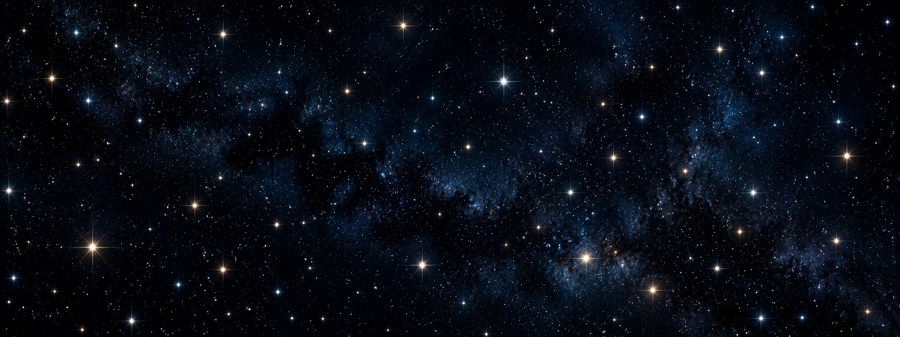

# Setara



**Astronomical image processing and photometric analysis**

An experimental framework for evaluating how image preprocessing and source separation affect astronomical photometric measurements across terrestrial and space-based imagery.

Setara accompanies a Master of Data Science thesis on **photometric processing enhancements to terrestrially acquired and space-based astronomical imagery**.

> **Project focus:** Understanding how image-level changes introduced by source separation propagate into photometric measurements.

## Overview

This research compares classical aperture-photometry measurements from a controlled baseline workflow with measurements obtained after **SCARLET-based source-separation preprocessing**.

The experimental framework was applied to two astronomical datasets:

- **SDSS** — ground-based astronomical imaging.
- **TESS** — space-based observations.

The repository contains the experimental source code, validation tests, documentation and exported results used in the thesis analysis.

Setara is the broader project identity. This repository represents the SCARLET-based research snapshot and can serve as a foundation for future experiments involving other preprocessing methods and astronomical datasets.

## Experimental workflow

```text
                   Astronomical image
                          |
             +------------+------------+
             |                         |
             v                         v
      Baseline workflow       SCARLET preprocessing
             |                         |
             v                         v
     Aperture photometry      Aperture photometry
             |                         |
             +------------+------------+
                          |
                          v
                Comparative evaluation
```

The baseline and SCARLET branches are evaluated under controlled photometric conditions to investigate differences associated with preprocessing.

The analysis considers changes in measured flux, variability, correspondence between baseline and SCARLET measurements, and preservation of temporal signal structure.

## Repository contents

```text
setara/
├── docs/                 # Project documentation
├── results/              # Experimental result exports
├── scarlet-source/       # SCARLET 1.0.1 source used in the study
├── src/                  # Research and experimental source code
├── tests/                # Project tests
├── validation/           # Validation and compatibility checks
├── requirements.txt      # Python dependencies
├── setup.cfg             # Project configuration
├── workflow-diagram.md   # Experimental workflow reference
└── README.md
```

## Experimental results

The `results/` directory contains exported experimental outputs used in the thesis analysis. These files allow the results to be inspected independently of the original local execution environment.

Raw SDSS and TESS FITS data are **not included** in this repository. The local experimental environment cached astronomical input data separately from the published source code and results.

## Scientific focus

The study investigates the photometric consequences of image preprocessing, with particular emphasis on:

- Measured photometric flux.
- Measurement variability and temporal stability.
- Correspondence between baseline and SCARLET measurements.
- Preservation of temporal signal structure.
- Differences across terrestrial and space-based observational conditions.

An important distinction is made between **image-level change** and **photometric improvement**. A change in measured flux or variability does not, by itself, establish improved photometric accuracy.

The evaluation is based on comparisons with the experimental baseline; changes relative to that baseline should not be interpreted as proof of accuracy against known photometric ground truth.

## Software environment

The experimental environment was developed and tested on Windows x64 using Python 3.14 and the following scientific Python libraries:

- NumPy
- SciPy
- Astropy
- Astroquery
- Photutils
- Lightkurve
- Matplotlib
- Pandas
- SCARLET 1.0.1

The dependency versions used in the experiment are recorded in `requirements.txt`.

## SCARLET preprocessing

The experiment uses **SCARLET 1.0.1** as its source-separation preprocessing stage. The source is retained in the `scarlet-source/` directory.

The local copy contains targeted compatibility modifications required to execute SCARLET 1.0.1 in the experimental Python, NumPy and SciPy environment. The source has not been broadly rewritten.

The native SCARLET extension requires a working Microsoft C++ build environment on Windows.

## Getting started

Create and activate a virtual environment from the repository root:

```powershell
python -m venv .venv
.\.venv\Scripts\Activate.ps1
```

Install the dependencies:

```powershell
python -m pip install --upgrade pip
python -m pip install -r requirements.txt
```

Verify the Python environment:

```powershell
python --version
python -c "import sys; print(sys.executable)"
```

### Building the SCARLET native extension

SCARLET 1.0.1 includes a native extension. Building it requires Microsoft C++ Build Tools with the **Desktop development with C++** workload.

From a Visual Studio Developer Command Prompt, with the project virtual environment activated:

```cmd
cd scarlet-source
python -m pip install pybind11
python setup.py build_ext --inplace
```

Verify the installation:

```cmd
python -c "import scarlet; print(scarlet.__file__); print(getattr(scarlet, '__version__', 'NO VERSION'))"
```

The expected SCARLET version is `1.0.1`.

## Running tests

Run the project tests from the repository root:

```powershell
python -m pytest tests -v
```

Run the SCARLET-specific preprocessing tests:

```powershell
python -m pytest tests/preprocessing/test_scarlet.py -v
```

These tests provide software and workflow validation. They are not a substitute for the scientific comparison performed on the astronomical datasets.

## Reproducibility

The repository preserves the source code and experimental outputs used in the thesis. Reproducing the full experiment also depends on the execution environment and underlying astronomical input data.

For reproducible execution, retain:

- The Python version and architecture.
- Dependency versions recorded in `requirements.txt`.
- The SCARLET 1.0.1 source and compatibility modifications.
- The relevant experiment configuration.
- The astronomical input data and their provenance.
- The exported experimental results.

Raw astronomical datasets are intentionally excluded because of their size and because the experiment obtained them through the relevant astronomical data services.

## Scope and status

**Current status: Experimental thesis repository / research snapshot**

This repository accompanies the thesis and provides access to the experimental setup and results underlying the reported analysis. It is not intended to represent a finished, general-purpose photometry package.

The current implementation reflects the experimental workflow used during the study. Future development may include simplifying the source tree, consolidating experiment configuration, improving documentation and making it easier to apply the framework to additional methods and datasets.

## Thesis context

**Thesis topic:** _Photometric processing enhancements to terrestrially acquired and space-based astronomical imagery._

The research provides a controlled comparison between baseline aperture photometry and SCARLET-enhanced preprocessing across SDSS and TESS observations.
